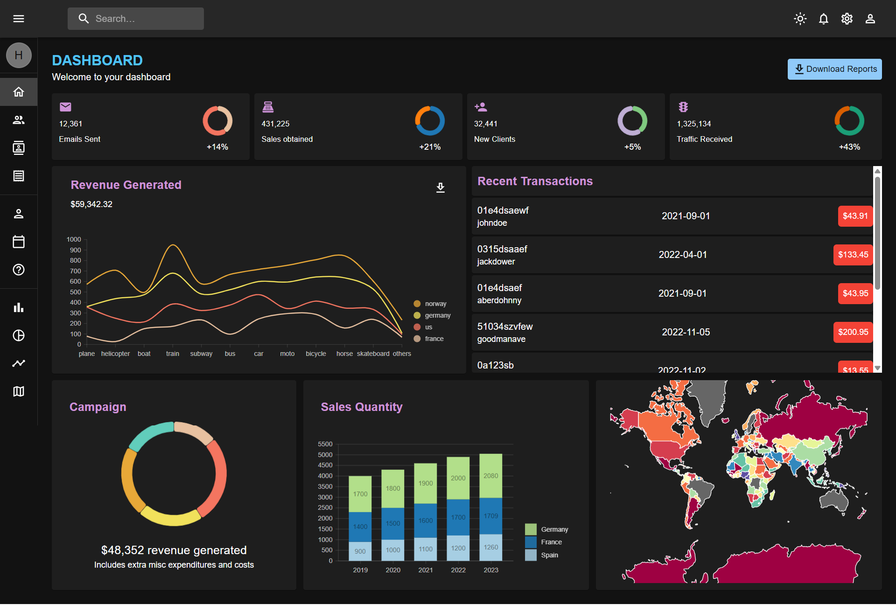
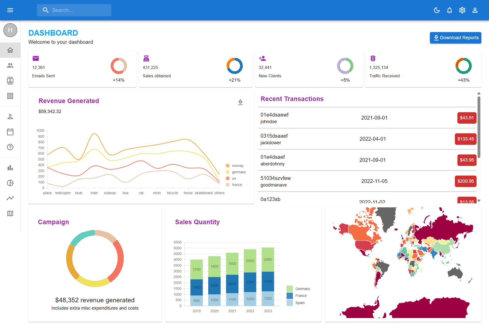
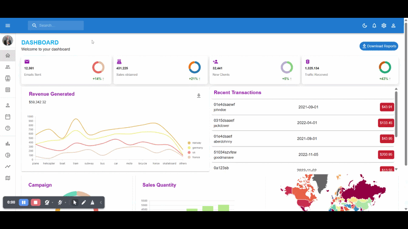

# React Admin Dashboard

A modern and responsive admin dashboard built with **React**, **Vite** and **Material UI**.  
This project is frontend-only and uses mock data to showcase a production-style admin experience.

## Live Demo

`https://react-admin-dashboard-seven-psi.vercel.app/`

## Screenshots

  


## Demo



## Features

- **Light / Dark mode** – theme toggle stored in `localStorage`.
- **Responsive layout** – works across desktop, tablet, and mobile breakpoints.
- **Sidebar navigation** – collapsible MUI drawer with active route highlighting.
- **Charts** – Line, Bar, Pie and Geography charts powered by Nivo.
- **Data tables** – team, contacts and invoices using MUI DataGrid.
- **Calendar integration** – interactive calendar built with FullCalendar.
- **Notifications page** – list of recent notifications (mock data).
- **Notifications dropdown** – quick access to recent events from the app bar bell icon.
- **User form with validation** – user creation form using React Hook Form + MUI.
- **Profile page** – simple profile view with avatar and account actions.
- **Fully component-based architecture** – reusable layout/header/card components.

## Tech Stack

**Frontend**
- React
- Vite
- Material UI (`@mui/material`, `@mui/icons-material`, `@mui/x-data-grid`)
- React Router (`react-router`, `react-router-dom`)
- React Hook Form
- Nivo Charts (`@nivo/bar`, `@nivo/line`, `@nivo/pie`, `@nivo/geo`)
- FullCalendar (`@fullcalendar/react`, `@fullcalendar/daygrid`, `@fullcalendar/timegrid`, `@fullcalendar/interaction`)

## Project Structure

High-level folders and key files:

- `src/`
  - `main.jsx` – React entry point, sets up `RouterProvider` and routes.
  - `App.jsx` – main layout shell (MUI theme provider, app bar, sidebar, and page `Outlet`).
  - `theme.jsx` – MUI theme configuration and light/dark design tokens.
- `src/components/`
  - `CustomAppBar.jsx` – top bar with search, theme toggle, notifications dropdown, settings and profile.
  - `SideBar.jsx` – collapsible navigation drawer with avatar, role label and grouped links.
  - `Header.jsx` – reusable page header for titles and subtitles.
- `src/pages/`
  - `dashboard/` – dashboard layout rows, KPI cards and supporting mock data.
  - `team/` – team management table (DataGrid).
  - `contacts/` – contacts listing with toolbar (DataGrid).
  - `invoices/` – invoices table with selection and toolbar (DataGrid).
  - `form/` – user creation form with validation and success snackbar.
  - `calendar/` – calendar page and event utilities.
  - `barChart/`, `pieChart/`, `lineChart/`, `geography/` – chart pages that wrap Nivo visualizations.
  - `notifications/` – full notifications page backed by mock data.
  - `profile/` – profile overview page.
  - `notFound/` – 404 fallback page.

The project is organized so that layout pieces live in `components/` and feature pages live in `pages/`, making it easy to extend with new routes and modules.

## Getting Started

### Prerequisites

- Node.js (LTS version recommended)
- npm (comes with Node) or another package manager like yarn / pnpm

### Installation

Clone the repository and install dependencies:

```bash
npm install
```

### Development

Start the Vite development server:

```bash
npm run dev
```

By default the app runs at `http://localhost:5173`.

### Production Build

Create an optimized production build:

```bash
npm run build
```

Preview the production build locally:

```bash
npm run preview
```

## Customization

- Replace mock data in tables, charts, notifications and profile with your own API data.
- Extend the MUI theme in `theme.jsx` (colors, typography, component overrides).
- Add new pages under `src/pages/` and routes in `src/main.jsx`.
- Wire up real authentication to protect specific routes (e.g. team, invoices, profile).

This project is designed as a polished frontend-only admin dashboard, suitable for portfolios and as a starting point for real-world admin interfaces.
